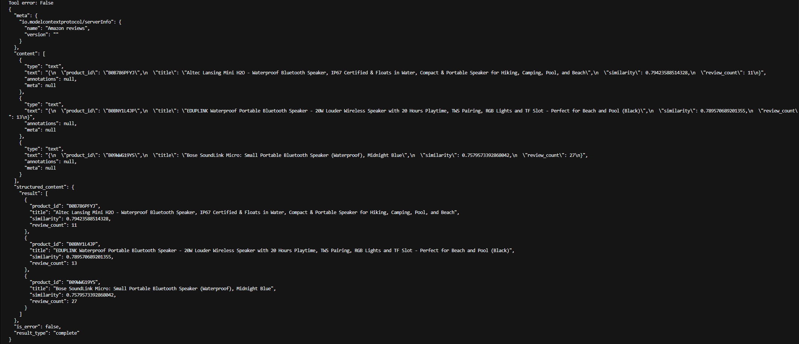
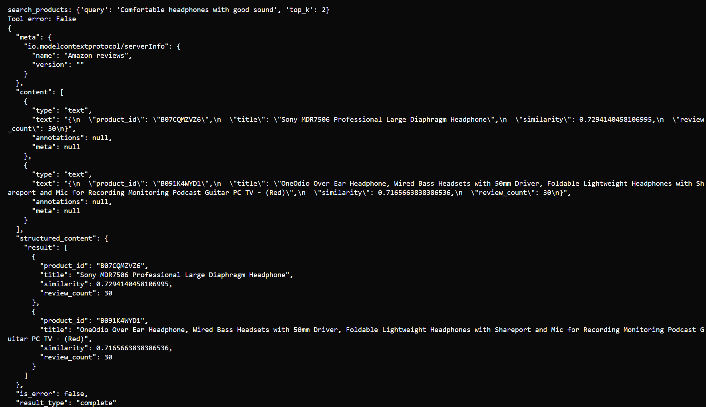

# Amazon Products — Búsqueda semántica y análisis con MCP

**Proyecto Final — Programación para Inteligencia Artificial**  
Maestría en Inteligencia Artificial · Universidad Autónoma de Yucatán (UADY)

## Descripción del proyecto

Este proyecto implementa un servidor MCP (*Model Context Protocol*) para realizar búsquedas semánticas, analizar valoraciones y comparar productos de Amazon Electronics.

Utiliza una selección del dataset **Amazon Reviews 2023**, que contiene:

- **600 productos** de la categoría Electronics.
- **6,992 reseñas** con texto.
- Todos los productos cuentan con al menos una reseña.

Para las búsquedas se utiliza el modelo `sentence-transformers/all-MiniLM-L6-v2`, que transforma los textos en vectores numéricos (*embeddings*) de 384 dimensiones.

El servidor combina información del catálogo con el contenido de las reseñas y utiliza PyTorch para calcular similitudes. Las estadísticas de valoraciones se calculan mediante NumPy.

La aplicación ofrece herramientas MCP a través de **Streamable HTTP** y funciona localmente.

## Estructura del proyecto

```text
amazon-products/
├── README.md
├── .python-version
├── pyproject.toml
├── uv.lock
├── config.json
├── server.py
├── client.py
├── main.py
├── support/
│   ├── __init__.py
│   ├── data.py
│   ├── settings.py
│   ├── encoder.py
│   ├── search.py
│   └── analysis.py
├── datasets/
│   ├── products.jsonl.gz
│   └── reviews.jsonl.gz
├── preparacion_datos.ipynb
├── test_embeddings.ipynb
├── test_search.ipynb
└── test_analysis.ipynb
```

Los archivos principales tienen las siguientes responsabilidades:

| Archivo | Responsabilidad |
|---|---|
| `server.py` | Inicialización de recursos y registro de herramientas MCP |
| `client.py` | Conexión HTTP, descubrimiento de herramientas y demostración |
| `main.py` | Ejecución del cliente asíncrono |
| `support/data.py` | Lectura y preparación de productos y reseñas |
| `support/settings.py` | Carga y validación de configuración |
| `support/encoder.py` | Codificación y combinación de embeddings |
| `support/search.py` | Búsqueda vectorizada y recuperación de resultados |
| `support/analysis.py` | Análisis estadístico y comparación de productos |

## Instalación

### Requisitos

- Python 3.13.16, indicado en `.python-version`.
- [uv](https://docs.astral.sh/uv/getting-started/installation/).
- Acceso a internet durante la instalación inicial de dependencias y la primera descarga del modelo.

### Obtener el proyecto

Obtener los archivos del proyecto y acceder a su directorio raíz, `amazon-products`, donde se encuentran `pyproject.toml`, `uv.lock` y `server.py`.

### Preparar el entorno

Desde la raíz del proyecto, ejecutar:

```powershell
uv python install 3.13.16
uv sync --locked
```

`uv` crea el entorno virtual `.venv` e instala las dependencias utilizando las versiones registradas en `uv.lock`.

No es necesario activar manualmente el entorno virtual al utilizar `uv run`.

Los archivos `products.jsonl.gz` y `reviews.jsonl.gz` deben permanecer dentro de `datasets/`. La aplicación los lee directamente en formato JSONL comprimido con gzip.

## Ejecución y funcionamiento

La aplicación utiliza dos procesos independientes: un servidor MCP que prepara y ofrece las herramientas, y un cliente que se conecta para utilizarlas.

Ambos procesos se ejecutan en terminales separadas, desde la raíz del proyecto, donde se encuentra `pyproject.toml`.

### Servidor MCP

En la primera terminal, ejecutar:

```powershell
uv run --locked python server.py
```

Al iniciarse, el servidor carga su configuración, prepara los datos y genera las representaciones vectoriales necesarias para realizar las búsquedas. **Nota:** la primera inicialización puede requerir descargar el modelo SentenceTransformer.

Una vez finalizada la inicialización, comienza a atender solicitudes mediante **Streamable HTTP** en:

`http://127.0.0.1:8000/mcp`

#### Configuración y construcción de embeddings

El archivo `config.json` define los parámetros del modelo:

```json
{
  "model_name": "sentence-transformers/all-MiniLM-L6-v2",
  "batch_size": 32,
  "device": "cpu"
}
```

La configuración se carga y valida mediante `support/settings.py`, utilizando Pydantic para comprobar que el nombre del modelo no esté vacío y que `batch_size` sea un entero positivo.

Durante la inicialización, el servidor realiza las siguientes operaciones:

1. **Preparación de datos:** `support/data.py` carga los productos y las reseñas y conserva sus identificadores para relacionarlos correctamente.
2. **Construcción del catálogo:** se forma una representación textual de cada producto utilizando su título, características y descripción disponible.
3. **Generación de embeddings:** `support/encoder.py` carga el modelo SentenceTransformer y codifica por separado los textos de catálogo y reseñas.
4. **Agrupación de reseñas:** los embeddings de las reseñas de cada producto se promedian y el vector resultante se normaliza.
5. **Combinación de representaciones:** se asigna un peso de **50 % al catálogo y 50 % a las reseñas**, seguido de una última normalización.

La matriz final tiene dimensiones `(600, 384)`.

**Regeneración:** los embeddings se calculan al iniciar el servidor y permanecen en memoria. No se almacenan en archivos independientes; basta con reiniciar el servidor para volver a generarlos. Los pesos del modelo descargado pueden reutilizarse desde su caché local.

### Cliente MCP

Una vez que el servidor está disponible, abrir una segunda terminal y ejecutar:

```powershell
uv run --locked python main.py
```

`main.py` inicia el cliente asíncrono definido en `client.py`, que se conecta al endpoint HTTP y descubre las herramientas MCP registradas por el servidor.

Las herramientas disponibles son `search_products`, `analyze_product` y `compare_products`.

El cliente incluido ejecuta una demostración predefinida de estas herramientas. Su comportamiento se describe en la sección **Demostración del cliente**.

## Herramientas MCP

### `search_products(query, top_k=5)`

Busca productos mediante similitud semántica.

**Parámetros:**

- `query`: descripción textual de lo que se desea buscar.
- `top_k`: cantidad máxima de resultados, entre 1 y 20.

**Resultado:** una lista ordenada por similitud descendente. Cada elemento contiene el identificador del producto, título, similitud y cantidad de reseñas seleccionadas.

Para realizar la búsqueda, `support/search.py` valida los parámetros y utiliza `support/encoder.py` para transformar la consulta en un embedding con el mismo modelo utilizado durante la inicialización.

La similitud coseno se calcula mediante el producto entre la matriz de productos normalizada y el vector de consulta normalizado. Posteriormente, se seleccionan los resultados con mayor similitud y se devuelven en orden descendente.

No se permiten consultas vacías ni valores inválidos de `top_k`.

### `analyze_product(product_id)`

Calcula estadísticas de las reseñas seleccionadas de un producto mediante `support/analysis.py`.

Devuelve:

- Cantidad de reseñas.
- Conteos de valoraciones de 1 a 5 estrellas.
- Proporciones correspondientes a cada valoración.
- Media y mediana de las calificaciones.

Si el identificador no existe en el dataset, se devuelven conteos y proporciones en cero, con media y mediana `null`.

### `compare_products(product_ids)`

Compara las estadísticas de dos o más productos diferentes utilizando `support/analysis.py`.

Devuelve el análisis individual de cada producto y las diferencias entre sus medias, utilizando el primer producto como referencia.

Si alguna de las medias necesarias no está disponible, la diferencia correspondiente se representa mediante `null`.

## Demostración del cliente

El cliente incluido en este repositorio está configurado como una demostración de las funcionalidades MCP.

Al ejecutar `main.py`, se llama a `demonstrate()` de `client.py`, que descubre las herramientas y realiza siete solicitudes predefinidas:

1. **Búsqueda semántica:** busca bocinas Bluetooth portátiles resistentes al agua con `top_k=3`.
2. **Análisis de producto:** obtiene las estadísticas de un producto conocido.
3. **Comparación:** compara las valoraciones de los 3 productos obtenidos en la busqueda del punto 1.
4. **Producto desconocido:** comprueba que se devuelven estadísticas vacías y valores `null` cuando corresponde.
5. **Entrada inválida:** envía una consulta con `top_k=0`, que produce un error controlado.
6. **Recuperación:** realiza una búsqueda válida de audífonos con `top_k=2`, después del error anterior.
7. **Comparación:** compara las valoraciones de los 2 productos obtenidos en la busqueda del punto 6.

La quinta llamada genera `is_error: true`. La sexta devuelve `is_error: false`, confirmando que el servidor continúa respondiendo correctamente dentro de la misma conexión MCP.

Esta demostración permite verificar las funcionalidades existentes, pero no es necesario utilizar `main.py` como punto de entrada en otras aplicaciones.

Se puede implementar un cliente propio compatible con MCP mediante Streamable HTTP para consumir las herramientas del servidor, ya sea desde una interfaz gráfica, una CLI u otra aplicación, sin modificar la implementación de búsqueda y análisis.

El archivo `client.py` proporciona un ejemplo de conexión y llamadas mediante el SDK de MCP.

Para detener el servidor, utilizar `Ctrl+C` en su terminal.

## Verificaciones de calidad

El proyecto se verificó utilizando Ruff y mypy sobre los nueve archivos Python de la aplicación.

### Análisis y formato con Ruff

```powershell
uv run --locked ruff check server.py client.py main.py support
uv run --locked ruff format --check server.py client.py main.py support
```

Resultados obtenidos:

```text
All checks passed!
9 files already formatted
```

En `support/data.py` se documentaron dos excepciones a la regla `TRY004` de Ruff mediante `# noqa: TRY004`, para conservar el uso uniforme de `ValueError` en las validaciones del dataset.

### Verificación de tipos con mypy

```powershell
uv run --locked mypy --strict server.py client.py main.py support
```

Resultado obtenido:

```text
Success: no issues found in 9 source files
```

## Ejemplos e interpretación de resultados

Los siguientes resultados corresponden a las consultas (Queries) realizadas mediante la demostracion en el [main.py](http://main.py). especificamente la consulta #1 y la Consulta #6.

### Ejemplo 1 — Bocina Bluetooth portátil resistente al agua

**En el Main aparece la siguiente Consulta:**

```json
"search_products",
{
    "query": "A portable waterproof Bluetooth speaker",
    "top_k": 3,
},
```

**Que se traduce a:**

```text
A portable waterproof Bluetooth speaker
```

**Parámetros:** `top_k=3`

**obtenemos la siguiente salida:**


**posteriormente realizamos la siguiente consulta:**

```json
"compare_products",
{"product_ids": ["B0B786PFYJ", "B0BNY1L4JP", "B09WWG19YS"]}
```

**Con el que obtenemos mas informacion de la consulta y ambas consultas se pueden traducir en la siguiente tabla:**

| Producto | Similitud | Reseñas | Media ★ | 1★ | 2★ | 3★ | 4★ | 5★ |
|---|---:|---:|---:|---:|---:|---:|---:|---:|
| Altec Lansing Mini H2O | 0.7942 | 11 | 4.91 | 0 | 0 | 0 | 1 | 10 |
| EDUPLINK Waterproof | 0.7896 | 13 | 4.62 | 1 | 0 | 0 | 1 | 11 |
| Bose SoundLink Micro | 0.7580 | 27 | 4.44 | 3 | 0 | 1 | 1 | 22 |

**Interpretación**

Los tres resultados son bocinas Bluetooth resistentes al agua.

La similitud más cercana la presenta el producto B0B786PFYJ con una diferencia de .0046 respecto al segundo resultado.
Esto es importante porque una mayor similitud no es necesariamente un indicador de que el producto tenga una mejor calidad o sea mejor o tenga una mayor resistente contra el agua.

Sin embargo, como podemos observar en la tabla, la media de calificación del primer producto es 4.91 lo que nos indica que al menos a los consumidores que han realizado reseñas les ha parecido satisfactoria. sin embargo 11 reseñas podrían considerarse muy pocas para poder decir que cubren una muestra representativa.

por eso a pesar de que nuestro sistema busque coincidencias que cumplen con los criterios de búsqueda y devuelven correctamente productos similares, no podemos tomar estos productos como recomendaciones de compra o considerar un ranking de calidad de productos.

### Ejemplo 2 — Audífonos cómodos con buen sonido

**En el Main aparece la siguiente Consulta:**

```json
"search_products",
{
    "query": "Comfortable headphones with good sound",
    "top_k": 2,
},
```

**Que se traduce a:**

```text
Comfortable headphones with good sound
```

**Parámetros:** `top_k=2`

**obtenemos la siguiente salida:**


**posteriormente realizamos la siguiente consulta:**

```json
"compare_products",
{"product_ids": ["B07CQMZVZ6", "B091K4WYD1"]}
```

**Con el que obtenemos mas informacion de la consulta y ambas consultas se pueden traducir en la siguiente tabla:**

| Producto | Similitud | Reseñas | Media ★ | 1★ | 2★ | 3★ | 4★ | 5★ |
|---|---:|---:|---:|---:|---:|---:|---:|---:|
| Sony MDR7506 | 0.7294 | 30 | 4.50 | 1 | 0 | 3 | 5 | 21 |
| OneOdio Over Ear | 0.7166 | 30 | 4.10 | 3 | 1 | 3 | 6 | 17 |

**Interpretación**

El buscador recupera dos productos, los Sony MDR7506 obtiene una similitud de 0.7294 y los OneOdio alcanza 0.7166.

Ambos audífonos que mencionan características comodidad.

Ambos resultados tienen 30 reseñas, lo que permite bastante mejor los productos por el tamaño de la muestra.

Como en el ejemplo anterior basándonos únicamente en la similitud no podemos definir que un producto sea mejor que otro. Sin embargo, una reseña negativa sobre comodidad puede ser semánticamente relevante para una consulta que menciona esa misma característica. Por ello, el ranking debe interpretarse como una medida de cercanía no como una recomendación definitiva de compra.

A pesar de que claramente en este ejemplo al comparar muestras de similares tamaños la media de estrellas de los audífonos Sony si revelan al menos una mejor satisfacción entre los clientes que escogieron este producto.

## Alcance y limitaciones

Este proyecto es una aplicación académica desarrollada sobre una selección limitada de Amazon Reviews 2023.

Sus principales limitaciones son:

- **Representatividad:** los 600 productos constituyen una muestra seleccionada por conveniencia, no aleatoria ni representativa de todo Amazon.
- **Cantidad de reseñas:** cada producto contiene entre 5 y 30 reseñas seleccionadas. Las estadísticas no representan necesariamente todas las valoraciones de Amazon.
- **Idioma:** el modelo de embeddings está orientado principalmente al inglés.
- **Longitud de textos:** el modelo trunca entradas superiores a 256 tokens de su tokenizador, por lo que algunos textos extensos pueden perder información.
- **Interpretación de similitud:** las puntuaciones indican cercanía semántica, no probabilidades, satisfacción del usuario ni calidad del producto.
- **Actualización:** la aplicación utiliza datasets locales y no consulta información actualizada de precios, inventario o nuevas reseñas.
- **Relevancia:** la búsqueda siempre recupera los candidatos más similares disponibles, incluso cuando ninguno coincide suficientemente con la intención del usuario.

Estas limitaciones deben considerarse al interpretar tanto las búsquedas como las estadísticas de valoraciones.

## Referencias

### Datos y tecnologías

- [Amazon Reviews 2023 — UCSD / McAuley Lab](https://amazon-reviews-2023.github.io/)
- [Dataset utilizado en el proyecto](https://github.com/oscarnavmac/programacion_ai/blob/main/proyecto-final/DATASET.md)
- [SentenceTransformers — Documentación oficial](https://www.sbert.net/)
- [Modelo all-MiniLM-L6-v2 — Hugging Face](https://huggingface.co/sentence-transformers/all-MiniLM-L6-v2)
- [Model Context Protocol — Documentación oficial](https://modelcontextprotocol.io/)
- [uv — Documentación oficial](https://docs.astral.sh/uv/)

### Origen académico

Este proyecto fue desarrollado como parte de la asignatura *Programación para Inteligencia Artificial* de la Maestría en Inteligencia Artificial de la Universidad Autónoma de Yucatán (UADY).

La implementación se desarrolló a partir de los requisitos y materiales proporcionados en el [repositorio académico del curso](https://github.com/oscarnavmac/programacion_ai), incluyendo la selección del dataset y las guías de desarrollo.