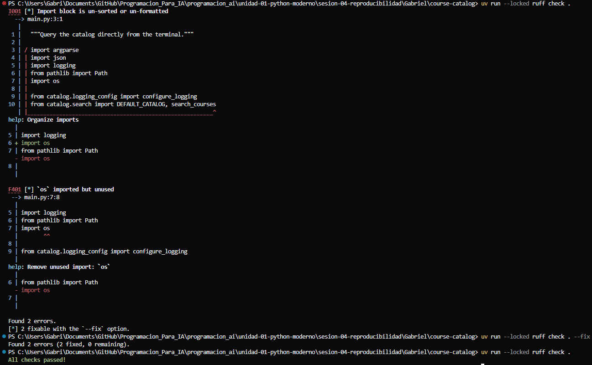
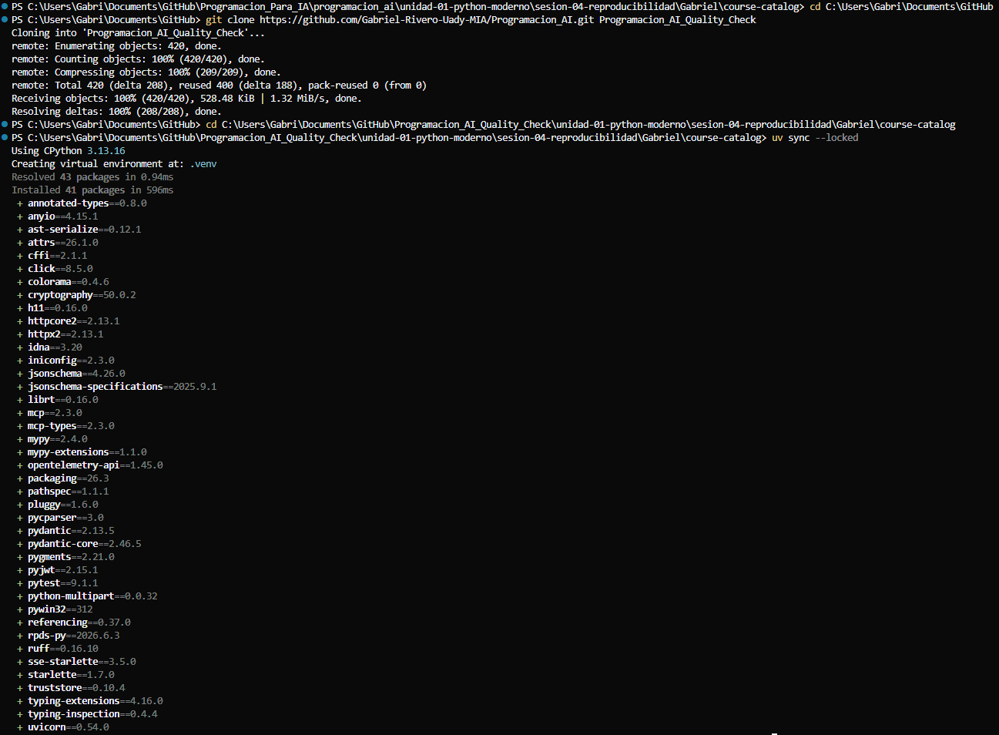
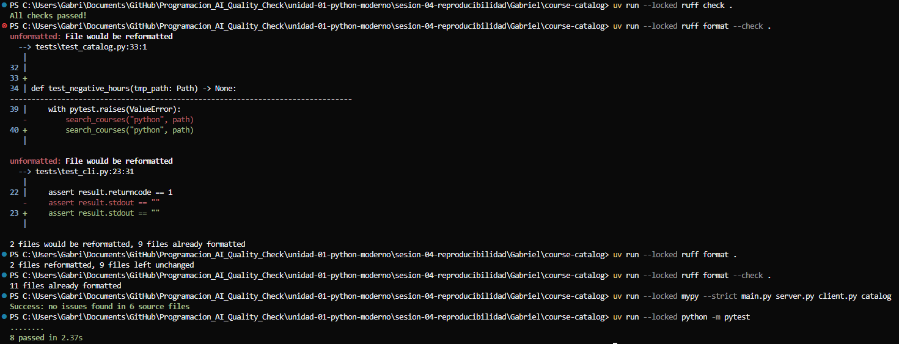
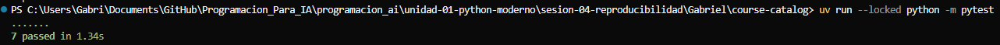
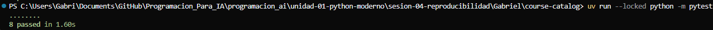

# Práctica · Sesión 4 — Organización y reproducibilidad con uv

Este README documenta los **siete ejercicios obligatorios**: los ejercicios 1–5 de [PRACTICA.md](../../PRACTICA.md) y los ejercicios 6–7 de [CALIDAD.md](../../CALIDAD.md#ejercicios-de-calidad). Las ocho secciones de [GUIA.md](../../GUIA.md) explican la construcción del proyecto y no son ejercicios adicionales.

Los comandos se ejecutan desde `course-catalog` en PowerShell, salvo donde se indique otra ubicación. Los resultados y las capturas corresponden a las comprobaciones realizadas previamente.

## Ejercicio 1 · Punto de entrada

### Comandos

```powershell
uv run python -c "import main"
```

### Resultado

El comando no produjo salida en la terminal.

### Explicación

import main no realiza la consulta porque la ejecución del main está dentro de la condición `if __name__ == "__main__"` , cuando usamos `import` el archivo se carga como modulo y python asigna a  `__name__` el valor `"main"`, y el if no se cumple por lo tanto no se ejecuta el `main()`. El caso de server.py es similar, la inicialización de transport ocurre dentro del if, por eso, si se registra `find courses` como herramienta, pero stdio no se inicializa.

## Ejercicio 2 · Datos y argumentos

### Comandos

Se copió `data/courses.json` a `data/extra_courses.json` y se agregó un curso cuyo título incluye Python.

```powershell
uv run python main.py python --catalog data/extra_courses.json
uv run python main.py python --catalog data/no_existe.json
$LASTEXITCODE
uv run --locked python client.py python
```

### Resultado

La consulta a `data/extra_courses.json` devolvió tres cursos cuyos títulos contienen Python.

La ruta inexistente produjo `FileNotFoundError: [Errno 2] No such file or directory: 'data\\no_existe.json'`; al consultar `$LASTEXITCODE` se obtuvo 1.

La llamada a `client.py` devolvió los dos cursos con Python del catálogo original.

### Explicación

Al utilizar el argumento `--catalog`, hacemos que `main.py` utilice un el archivo que le designemos a continuación, en nuestro archivo nuevo `extra_courses.json` existen ahora 3 cursos que coinciden con Python. 
En el ejemplo con una ruta inexistente, `search_courses()` no puede abrir un archivo y se genera una excepción. `main.py` devuelve el error con el código de salida 1. 
Como MCP tiene el catálogo original como predeterminado, cuando se realiza la consulta se utiliza `DEFAULT_CATALOG` que apunta a `data/courses.json` por lo que nos devuelve los unicamente 2 cursos originales.

## Ejercicio 3 · Niveles y destinos

### Comandos

```powershell
uv run python main.py python --log-level DEBUG
uv run python main.py python --log-level INFO
uv run python main.py python --log-level ERROR
uv run python main.py python --log-level ERROR --log-file logs/app.log
```

### Resultado

Con DEBUG aparecen mensajes DEBUG e INFO en la terminal, además del resultado JSON. Con INFO aparece el mensaje INFO y el JSON. Con ERROR solo se imprime el JSON, porque la consulta no genera errores.

Al agregar `--log-file logs/app.log`, el archivo conserva mensajes DEBUG e INFO aunque la consola esté configurada en ERROR. Esta consulta correcta no genera mensajes ERROR.

### Explicación

En este ejercicio observamos 2 conceptos trabajando:
`StreamHandler` maneja los mensajes de la consola que se configuran con `--log-level`. dependiendo del nivel seleccionado, se muestran distintos mensajes en la consola. 
`FileHandler` maneja los mensajes que se guardan en archivos y está configurado con el nivel `DEBUG` por eso en el archivo de `app.log` se conservar los niveles inferiores, aunque en la consola se filtren.
`stdout` se debe reservar para el protocolo MCP porque estamos usando `stdio` como transporte. Los mensajes del cliente y el servidor se intercambian en `stdout`. Si enviáramos mensajes a la consola con `print()` que tambien salen por `stdout` podríamos mezclar esos mensajes con el protocolo y corromper la comunicación. por esta razón los logs se envían con `stderr` y reservar `stdout` para el protocolo.

## Ejercicio 4 · Mejorar el diagnóstico

### Comandos

El mensaje INFO de `catalog/search.py` incluye las coincidencias y el total de cursos leídos mediante argumentos de logging:

```python
logger.info(
    "Search completed: %d matches from %d total courses",
    len(matches),
    len(courses),
)
```

```powershell
uv run python main.py python
uv run --locked python client.py python
```

### Resultado

La consulta directa mostró `INFO | catalog.search | Search completed: 2 matches from 3 total courses` y devolvió los cursos `PY01` y `PY02`.

La llamada MCP devolvió los mismos cursos y terminó correctamente, pero el mensaje nuevo no apareció en el resultado mostrado por el cliente.

### Explicación

En la llamada MCP el nuevo mensaje `INFO` no forma parte del resultado que se le envía al cliente, este pertenece al sistema de logging del servidor y no a al que devuelve la herramienta.

## Ejercicio 5 · Reproducción y llamada MCP

### Comandos

Se creó una copia limpia del repositorio en `Programacion_AI_Check\unidad-01-python-moderno\sesion-04-reproducibilidad\Gabriel\course-catalog`. Desde esa carpeta se ejecutó:

```powershell
uv sync --locked
uv run --locked python client.py python
uv run --locked python client.py astronomy
uv run --locked python client.py " "
```

### Resultado

El entorno se reconstruyó correctamente con `uv sync --locked`. La consulta `python` descubrió la herramienta `find_courses` y devolvió los cursos `PY01` y `PY02`.

`astronomy` devolvió una lista vacía con `"is_error": false`. La cadena de espacios produjo un error con `"is_error": true`.

### Explicación

`pyproject.toml` declara la configuración principal del proyecto, así como sus dependencias. 
`uv.lock` guarda las versiones de las dependencias para que el entorno se puede reconstruir de manera consistente. 
`.python-version` nos indica la versión de Python que será utilizada en el proyecto.
`.venv` no es necesario entregarlo por es un entorno reconstruible y local. Se genera a partir de los archivos al usar `uv sync --locked`. 
No tener coincidencias es un resultado valido, simplemente se regresa una lista vacía con `"is_error": false`. Por otro lado, una búsqueda con argumento vacío no es válido y nos devuelve el `"is_error": true`.

## Ejercicio 6 · Corregir un aviso de Ruff

### Comandos

Durante la comprobación se agregó temporalmente un import sin usar en `main.py`:

```python
import argparse
import json
import logging
from pathlib import Path
import os  # Import agregado sin utilizar
```

Se comprobó el aviso, se corrigió y se verificó el resultado:

```powershell
uv run --locked ruff check .
uv run --locked ruff check . --fix
uv run --locked ruff check .
```

### Resultado



### Explicación

Ruff detecto 2 problemas `F401` porque estamos importando algo que no estamos usando y `I001` porque el import está en desorden. Después ejecutamos `ruff check . --fix` que corrigió ambos errores y verificamos, por último, con `uv run --locked ruff check .` y ya obtenemos "All checks passed!".

## Ejercicio 7 · Comprobar desde una copia limpia

### Comandos

Se clonó el repositorio en otra carpeta limpia:

```powershell
cd C:\Users\Gabri\Documents\GitHub
git clone https://github.com/Gabriel-Rivero-Uady-MIA/Programacion_AI.git Programacion_AI_Quality_Check
cd C:\Users\Gabri\Documents\GitHub\Programacion_AI_Quality_Check\unidad-01-python-moderno\sesion-04-reproducibilidad\Gabriel\course-catalog
```

Desde esa carpeta se reconstruyó el entorno y se ejecutaron las comprobaciones:

```powershell
uv sync --locked
uv run --locked ruff check .
uv run --locked ruff format --check .
uv run --locked mypy --strict main.py server.py client.py catalog
uv run --locked python -m pytest
```

En la comprobación previa, Ruff indicó que dos archivos requerían formato. El comando correcto para aplicar el formato y volver a comprobarlo es:

```powershell
uv run --locked ruff format .
uv run --locked ruff check .
uv run --locked ruff format --check .
uv run --locked mypy --strict main.py server.py client.py catalog
uv run --locked python -m pytest
```

### Resultado





### Explicación

Desde la copia limpia del proyecto en `Programacion_AI_Quality_Check` se ejecutó `uv sync --locked` que creo un nuevo `.venv` con todas las dependencias fijas del proyecto. Se ejecutaron entonces las verificaciones y ruff detecto 2 archivos que requerian correccion, se ejecutó `uv run --locked ruff format .` y se verifico nuevamente, ruff confirmo 11 archivos correctamente formateados, mypy reporto 0 problemas y pytest completo las 8 pruebas correctamente.

## Pruebas adicionales (opcionales)

Estas dos pruebas se realizaron antes de la actualización de las guías y se conservan como trabajo adicional con sus evidencias. No forman parte de los siete ejercicios obligatorios. Las guías actuales piden ejecutar las pruebas existentes, sin crear pruebas nuevas.

### Prueba opcional A · Horas negativas

#### Comandos

Se agregó esta prueba en [tests/test_catalog.py](tests/test_catalog.py):

```python
def test_negative_hours(tmp_path: Path) -> None:
    path = tmp_path / "courses_negative.json"
    path.write_text(
        json.dumps([{"code": "X2", "title": "Python avanzado", "hours": -5}])
    )
    with pytest.raises(ValueError):
        search_courses("python", path)
```

```powershell
uv run --locked python -m pytest
```

#### Resultado

Todas las pruebas pasaron en la ejecución documentada.



#### Explicación

El modelo Course define horas como estrictamente mayores que 0 (`Field(gt=0)`), Pydantic rechazo los valores mejores 0 iguales a cero y la prueba confirma que se comportó de manera adecuada y nos devuelve que todas las pruebas pasaron con éxito.

### Prueba opcional B · Archivo inexistente en la consola

#### Comandos

Se creó [tests/test_cli.py](tests/test_cli.py) con `subprocess.run` y el directorio temporal `tmp_path` de pytest.

```powershell
uv run --locked python -m pytest
```

#### Resultado



#### Explicación

La prueba confirma que la instancia termina con código 1 y que stdout queda vacío. con tmp_path se generó una ruta temporal para no depender de los archivos del proyecto.

